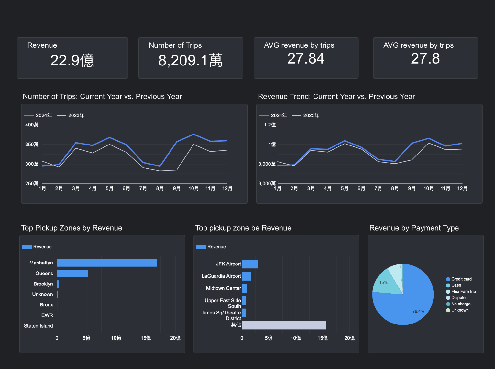
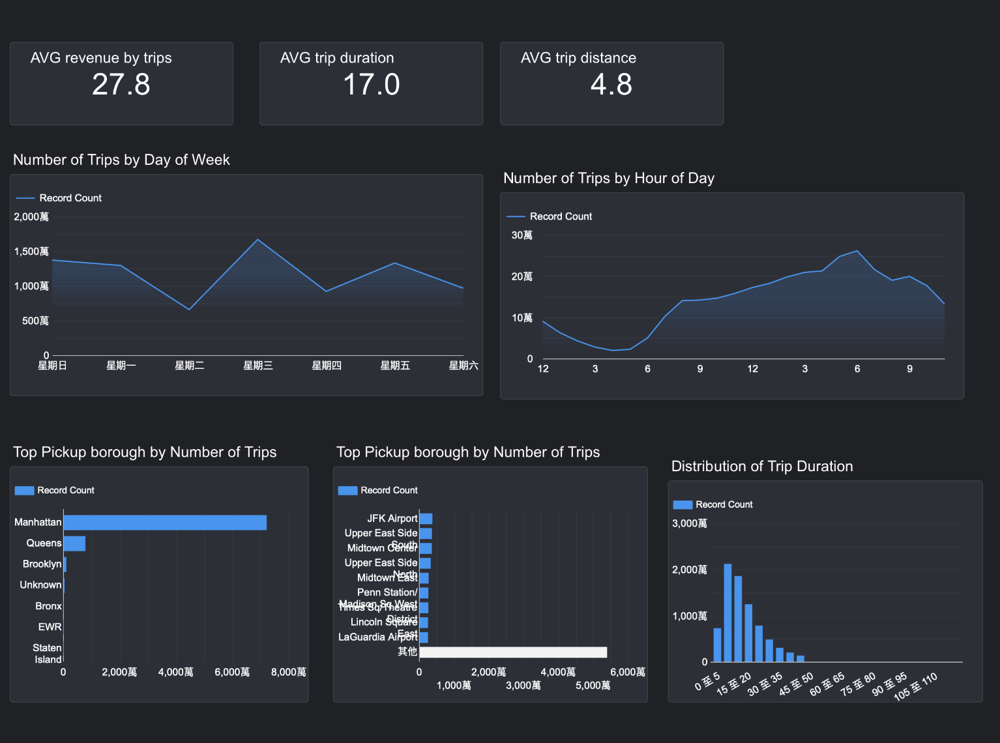
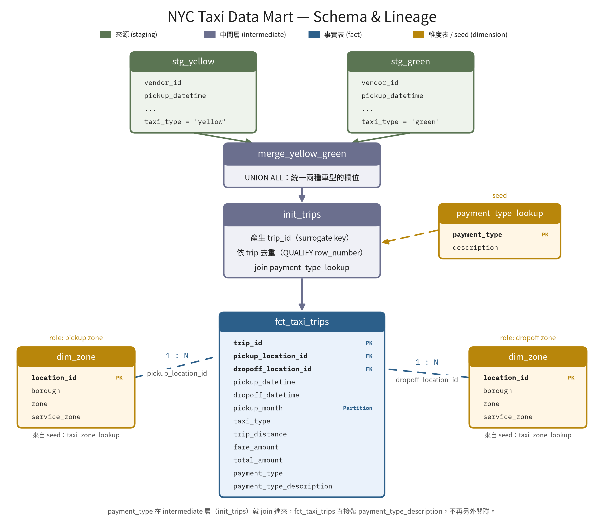
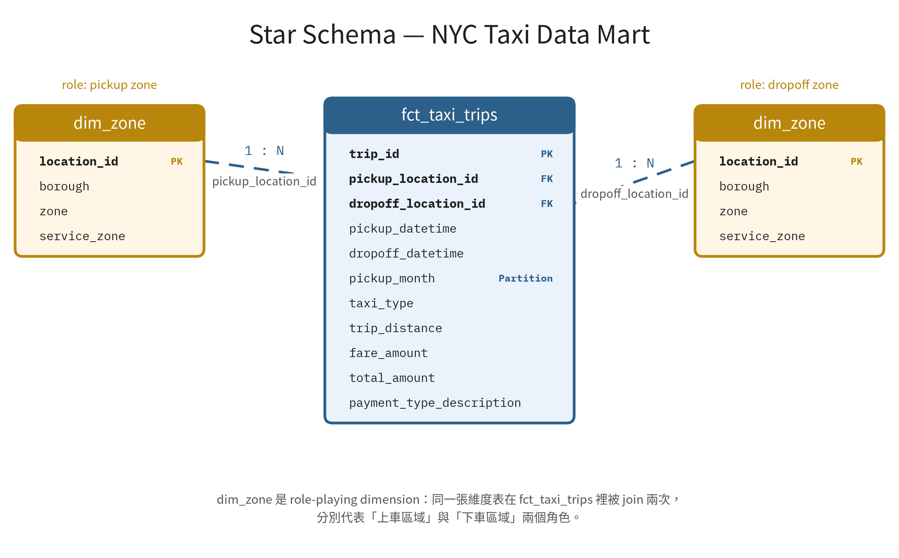
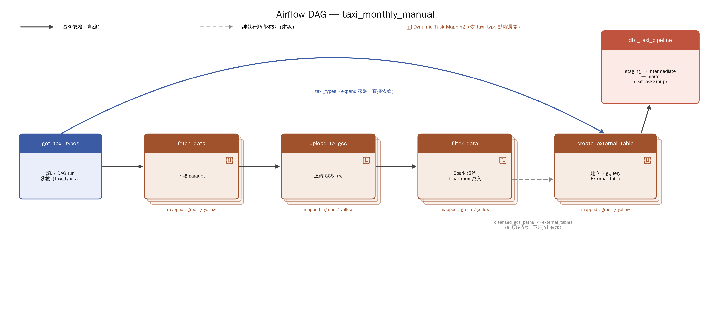
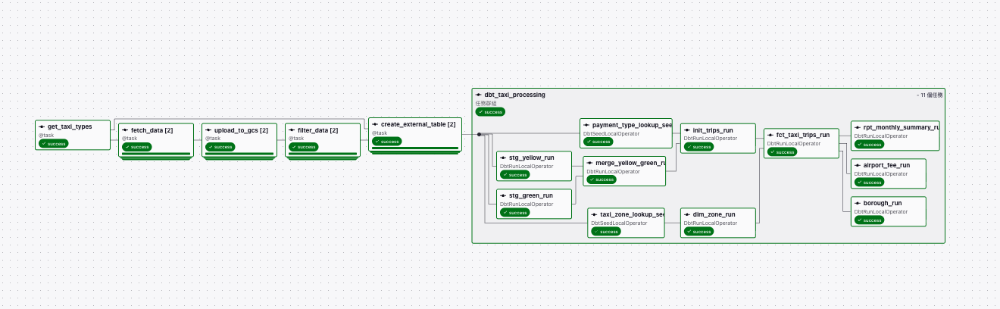

# 🚕 NYC Taxi Data Pipeline

[English](README.md) | **繁體中文**

## 專案概述

  
  

---

## 資料

### 資料集概述

- 本專案使用 [紐約市計程車與禮車委員會（TLC）](https://www.nyc.gov/site/tlc/about/tlc-trip-record-data.page) 公開提供的行程紀錄資料。
- 資料集是紐約市各地計程車營運所產生的**逐趟交易紀錄**，每**月**發布一次。
- 每筆行程紀錄包含：
  - 上車與下車時間
  - 上車與下車地點
  - 行程距離
  - 車資金額
  - 付款方式
  - 乘客人數
  - 服務類型

### 計程車服務類型

紐約市有多種計程車服務，本專案聚焦在以下兩種：

- **黃色計程車（Yellow Taxi）**
  - 黃色計程車可以在紐約市大部分行政區載客，常見於：
    - 曼哈頓商業區
    - 觀光景點
    - 機場
    - 高需求的都會區
  - 黃色計程車占紐約市計程車行程的最大宗。

- **綠色計程車（Green Taxi）**
  - 綠色計程車是為了改善黃色計程車較少服務地區的交通而推出，主要在以下地區載客：
    - 上曼哈頓
    - 布朗克斯
    - 布魯克林
    - 史泰登島
  - 綠色計程車較常由在外圍行政區社區之間移動的當地居民使用。

兩種計程車都受 TLC 管理，採用相似的跳表計費結構。

### 資料集特性

- TLC 資料以 **Parquet 格式**發布，適合大規模的分析處理。
- 資料量：黃色計程車的行程數通常明顯較多，檔案也較大。

### 資料品質考量

使用 TLC 資料時，需要注意以下幾個資料品質問題：

- 不同的計程車服務類型，schema 可能不同。
- 每個月份、每種服務類型的資料完整度不一。
- 部分紀錄有缺漏或無效的值，需要清洗。

### 小結

由於 TLC 資料集**每月發布**，加上業務需求以分析為主，本專案實作一條**每月批次處理的 pipeline**：匯入 NYC TLC 行程紀錄、統一不同計程車服務類型的資料，並把原始資料轉換成**可直接分析的資料集**，供下游報表與商業智慧使用。

---

## 系統架構

---

## 資料流程

資料流程設計為每月執行的批次工作流程，把 NYC TLC 行程紀錄從原始資料匯入，一路處理到可直接分析的資料表。

1. **資料匯入**
   - 下載 Parquet 格式的原始資料。
   - 把原始檔案上傳到 Google Cloud Storage，作為 Data Lake。
2. **資料處理**
   - 用 **Apache Spark** 從 GCS 讀取原始 Parquet 檔案。
   - 進行基本的資料清洗與 schema 標準化。
   - 依**年**、**月**分區（partition）儲存處理後的資料，提升儲存與查詢效率。
3. **建立 External Table**
   - 在 GCS 上處理好的 Parquet 檔案之上，建立 **BigQuery External Table**。
   - 啟用 **Hive 風格分區**，提升查詢效能。
4. **資料建模**
   - 用 **dbt** 把 External Table 轉換成可直接分析的資料模型。
   - 依分層建模的方式，建立 **staging**、**intermediate**、**mart** 三層。
5. **分析輸出**
   - 產生事實表與報表用資料表，供下游分析、商業智慧與報表使用。

## 資料儲存

本專案採用分層的儲存架構，包含 Data Lake、BigQuery External Table 與 Data Warehouse，每一層在資料流程中負責不同的工作。

### Data Lake

Data Lake 用來存放大量原始、尚未處理的資料，之後再轉換成分析用的格式。和傳統資料庫相比，Data Lake 提供：

- 大量資料的低成本儲存
- Schema-on-read 的彈性
- 歷史資料的長期保存
- 業務需求改變時，可以重新處理資料

本專案使用 Google Cloud Storage（GCS）作為 Data Lake，因為它提供可擴展的物件儲存，也能和 BigQuery 等 Google Cloud 服務無縫整合。

處理後的計程車行程紀錄以 Parquet 格式儲存，並依以下欄位分區：

- 年
- 月

這個分區策略可以減少查詢時掃描的資料量，提升查詢效能並降低查詢費用。

為了做到分區，本專案用 Spark 進行資料清洗與 schema 標準化，再把分區後的 Parquet 檔案寫回 GCS。好處包括：

- 平行處理資料
- 平行寫入檔案
- 透過分散式執行降低記憶體壓力
- 從分區儲存中更快讀取資料

使用 Spark 可以有效率地進行分散式處理，並擴展到大型資料集。

### BigQuery External Table

BigQuery External Table 讓 BigQuery 可以直接查詢存放在 GCS 的資料，不需要把檔案匯入資料倉儲。

本專案直接在 GCS 上處理好的 Parquet 檔案之上建立 External Table，好處包括：

- 避免重複儲存資料
- 降低儲存成本
- 可以立即存取 Data Lake 裡的檔案
- 簡化資料匯入流程

這一層是 Data Lake 與分析層之間的橋梁。

### Data Warehouse

經過 dbt 轉換後，整理好的資料集會實體化（materialize）在 BigQuery，作為本專案的資料倉儲。

和 Data Lake 不同，Data Warehouse 存放的是結構化、可直接分析的資料，針對線上分析處理（OLAP）最佳化。

資料倉儲支援以下下游用途：

- 業務報表
- 儀表板
- 資料分析
- 商業智慧

BigQuery 是全代管、serverless 的資料倉儲，提供：

- 高效能的分析查詢
- 自動擴展
- 不需要管理基礎設施
- 依查詢量計費

## 資料建模

本專案使用 **dbt** 實作 **Medallion 架構**，把資料分成 Staging、Intermediate、Mart 三層。

分層設計能提升可維護性、資料品質與模型的重用性，也讓轉換流程中各層的職責清楚分開。

選用 dbt 作為轉換框架，是因為它提供：

- 以 SQL 撰寫資料轉換
- 透過模型之間的 ref 管理相依關係
- 內建資料品質測試
- 資料血緣（lineage）視覺化

### Staging 層

Staging 層負責把 External Table 裡的原始計程車資料標準化。在本專案中的主要工作：

- 統一欄位名稱與資料型別
- 讓不同計程車服務類型有一致的 schema
- 為下游轉換準備來源資料

這一層的模型實體化為 **view**，以**降低儲存成本，並讓轉換保持輕量**。

### Intermediate 層

Intermediate 層負責整合多種計程車服務類型的資料，並補充資訊。主要工作：

- 把黃色與綠色計程車的資料合併成統一的 schema
- 產生 surrogate key
- 移除重複紀錄
- 為行程紀錄補充其他業務屬性

這一層產出可重用的業務實體，作為下游分析模型的基礎。

### Mart 層

Mart 層提供針對報表與業務分析最佳化、可直接分析的資料集。

由於 TLC 資料集每月發布，Mart 層實體化為 **incremental table**，每次只處理新的月份分區，不必重建整個資料集。

主要工作：

- 建立事實表與維度表
- 支援增量載入
- 為行程資料補上地點維度
- 最佳化分析查詢效能
- 提供下游報表與儀表板使用的資料集

### 實體化策略

專案中各層採用不同的實體化策略，在查詢效能、儲存成本與可維護性之間取得平衡。

| 分層 | 實體化方式 | 原因 |
|---|---|---|
| Staging | View | 降低儲存成本 |
| Intermediate | View | 可重用的轉換層 |
| Mart | Incremental Table | 每月有效率地更新 |

### 報表

以 Mart 層的模型為基礎，建立以業務為導向的報表資料表，支援以下分析：

- 機場費用分析
- 各行政區的交通分析
- 每月計程車活動摘要
- 營收與行程量報表

---

## 工作流程設計

本專案使用 Apache Airflow 編排端到端的資料流程。編排層負責協調各系統之間的工作執行，包含 Google Cloud Storage、Spark、BigQuery 與 dbt。

### 主要功能

- **每月排程**

  NYC TLC 資料集**每月發布**，因此 pipeline 每月執行一次，確保新資料發布後才開始處理。這樣可以避免不必要的執行，也讓工作流程和資料發布週期一致。

- **任務相依**

  Pipeline 包含資料匯入、處理、儲存與轉換等多個依序執行的階段。任務相依關係確保每個階段都在上游任務成功完成後才開始，避免不完整或不一致的資料流入後續流程。

- **參數化執行**

  觸發工作流程時，可以指定一種或多種計程車服務類型（例如黃色或綠色計程車）。

  這個設計避免重複撰寫 DAG 邏輯，讓同一個工作流程可以用相同的處理流程，處理多個資料集。

- **Dynamic Task Mapping**

  Airflow 會依照選擇的計程車服務類型，在執行時動態產生處理任務。

  之後新增其他計程車服務或資料集時，工作流程可以自然擴展，不需要修改 DAG 結構。

- **選擇性回補（Selective Backfill）**

  可以只針對特定的計程車服務類型與時間區間，重新處理歷史資料。

  不必重跑整條 pipeline，只回補受影響的資料集（例如 5 月的黃色計程車），能降低運算成本、縮短復原時間，也讓錯誤修正更有效率。

---

## 挑戰

### Schema 標準化

黃色與綠色計程車的資料集 schema 略有不同，必須先對齊 schema，才能進行下游轉換。

### 儲存與查詢分離

Pipeline 不把原始資料直接載入 BigQuery，而是結合 GCS 與 BigQuery External Table，把儲存和運算分開，同時減少重複儲存。

### 增量資料處理

資料集每月發布，如果每次執行都重建整個資料倉儲，會很沒有效率。

因此 Mart 層使用 incremental 模型，只處理新發布的分區。

### 彈性的工作流程設計

支援多種計程車服務類型，讓工作流程變得更複雜。

透過參數化執行搭配 Dynamic Task Mapping，單一 DAG 就能處理不同的資料集，同時支援選擇性回補。

---

## 參考資料

本專案的靈感來自 [2026 Data Engineering Zoomcamp](https://github.com/DataTalksClub/data-engineering-zoomcamp) 的 dbt 單元（第 4 章）。

我以課程介紹的資料建模概念為基礎，把專案延伸成一條完整的端到端資料流程，實作了：

- 從 NYC TLC 資料集匯入資料
- 以 Google Cloud Storage（GCS）作為 Data Lake
- 以 Apache Spark 進行資料前處理與分區
- 以 BigQuery External Table 查詢存放在 GCS 的資料
- 以 Apache Airflow 進行工作流程編排、排程與回補
- 以 dbt 採用 Medallion 架構進行分層資料建模

dbt 的建模方式參考了課程內容，但整體的 pipeline 架構、儲存設計、工作流程編排與實作，都是獨立設計與開發的。
